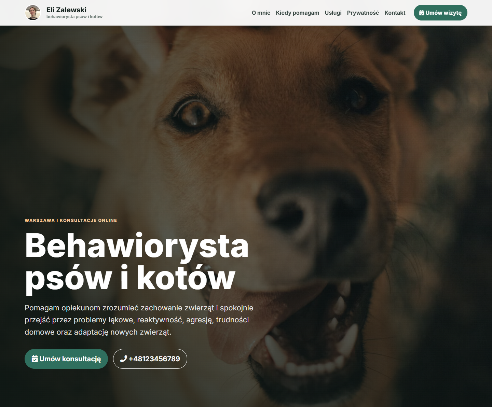
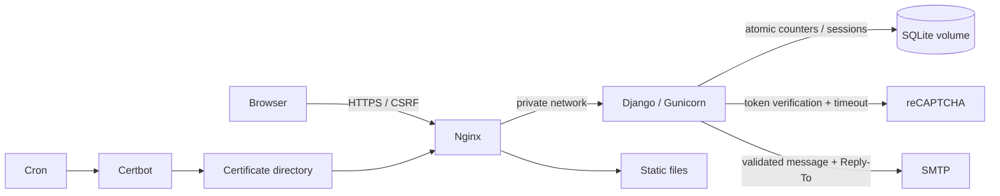

# Behawiorysta — Django service website

[Live site](https://behawiorysta.warszawa.pl/) · [Deployment guide](DEPLOYMENT.md)

Production-oriented website for an animal behaviour specialist in Warsaw: service
catalogue, pricing, contact requests and search-engine metadata. The contact form
sends a consultation request by email; it does **not** reserve an appointment.
The provider confirms availability separately.

<p align="center">
  <a href="docs/screenshot.png">
    
  </a>
</p>

The screenshot is generated from the local application with example contact
details and reCAPTCHA disabled.
[Full desktop preview](docs/screenshot.png) · [Mobile preview](docs/mobile.png).

## Stack and architecture

Python 3.13, Django 5.2 LTS, SQLite, Gunicorn, Nginx, Docker Compose,
Certbot / Let's Encrypt, Bootstrap 5, Ruff, unittest and GitHub Actions.



- **Validated forms:** server-side length limits, email and phone validation,
  whitelisted service choices, required consents and a date within 90 days.
  Invalid submissions retain values and show field errors.
- **Abuse protection:** 5 attempts / 15 minutes and 3 accepted sends / hour
  per IP by default. Fixed-window counters live in SQLite and are shared across
  Gunicorn workers. Atomic conditional updates reserve capacity before SMTP.
  Failed SMTP attempts release the send slot but still count as attempts.
- **Failure handling:** reCAPTCHA validates hostname and uses connection/read
  timeouts; network errors, bad JSON and failed verification block sending.
  SMTP failures return a recoverable error. Logs contain event names, not
  submitted messages or credentials.
- **Email identity:** a configured sender and recipient list, with the visitor
  in Reply-To. Neither recipient nor price can be selected by forged form input.
- **Consistent SEO:** catalogue in `website/catalog.py` feeds cards, form choices
  and JSON-LD. Canonical URLs, social metadata, robots and sitemap use SITE_URL.
- **Deployment:** non-root app container, persistent database volume, automatic
  migrations, certificate bootstrap and cron renewal.

## Run locally

```bash
python -m venv .venv
source .venv/bin/activate
# Windows PowerShell: .\.venv\Scripts\Activate.ps1
pip install -r requirements-dev.txt
cp .env.example .env.local
python manage.py migrate
python manage.py runserver
```

Open http://localhost:8000. Development emails are printed in the terminal.
`requirements.txt` pins production dependencies, including their transitive
dependencies. `requirements-dev.txt` adds the lint, audit, coverage and browser
testing tools; these tools are not installed in the production image.
The example disables reCAPTCHA **only for development**; production rejects
disabled verification. Do not use real personal data in demonstration requests.

Environment variables override the dotenv file. The default file is
`.env.local`; set `DJANGO_ENV_FILE` to select another file. Compose injects
`.env.prod` directly. See [.env.example](.env.example) for application variables
and [.env.ssl.example](.env.ssl.example) for certificate hostnames.

## Quality checks

```bash
ruff check .
ruff format --check .
python manage.py check --settings=djangoBehawiorysta.test_settings
python manage.py makemigrations --check --dry-run --settings=djangoBehawiorysta.test_settings
coverage run --source=website manage.py test --settings=djangoBehawiorysta.test_settings
coverage report
pip-audit -r requirements.txt
```

Tests use an isolated in-memory database, mocked Google responses and Django's
in-memory email backend. They cover invalid input, consent, CSRF, SMTP failure,
reCAPTCHA failure, rate-limit windows, proxy IP handling and SEO output.
GitHub Actions runs checks for pushes and pull requests; a weekly run also
detects vulnerabilities disclosed after the last commit.

Generate fresh screenshots without sending email or touching the development DB:

```bash
python -m playwright install chromium
python scripts/capture_screenshot.py
# With installed Microsoft Edge: python scripts/capture_screenshot.py --channel msedge
```

## Deployment and data

Follow [DEPLOYMENT.md](DEPLOYMENT.md), especially the migration instructions when
upgrading an existing VPS. SQLite resides in the named `database` volume at
`/app/data/db.sqlite3`; rebuilding the app does not remove it. A consistent backup
command and restore procedure are documented there.

SQLite is intentional for a low-traffic, single-VPS service. It stores Django
sessions and short-lived, HMAC-keyed rate counters; contact messages are delivered
to email, not saved as application records. Counters are deleted by daily
maintenance. The IP key is pseudonymous, not a claim of irreversible anonymity.

## Scope and trade-offs

- Fixed windows allow bursts around window boundaries; IP limits also affect
  visitors sharing a NAT. They are spam protection, not DDoS protection.
- SMTP is synchronous and bounded by a timeout. An ambiguous SMTP disconnect can
  still deliver a message; retries are not an exactly-once delivery guarantee.
  A durable outbox and worker would be appropriate for higher traffic.
- SQLite supports one writer at a time. For multiple app hosts or sustained
  concurrent writes, migrate to PostgreSQL and a shared rate-limit service.
- TRUST_PROXY_IP is enabled only by Compose, where Nginx overwrites X-Real-IP and
  the app port is not public. Additional proxies/CDNs require a deliberate trusted
  proxy configuration.
- No newsletter subscription is implemented; the unused checkbox was removed.
  Full street address is not needed for the initial request.
- The site loads third-party fonts, scripts and reCAPTCHA. The operator must
  maintain an accurate privacy notice and provider configuration; the code does
  not establish legal compliance.
- Business copy and photographs belong to this site's content. No permission to
  reuse those assets is implied by this repository.
